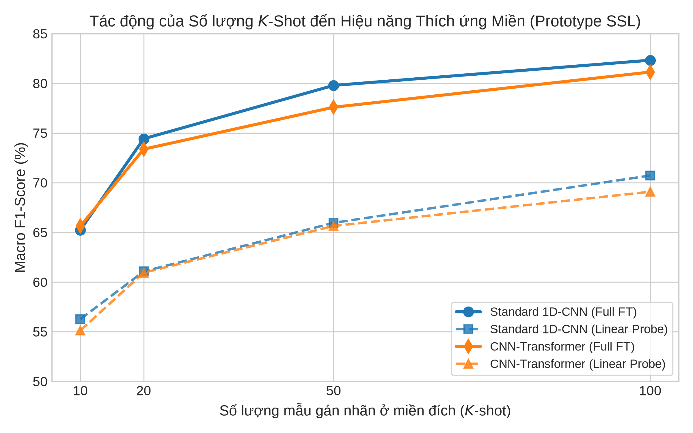
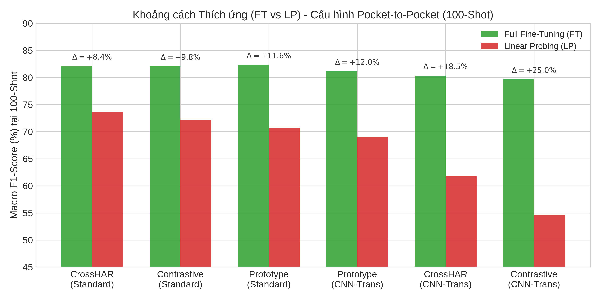
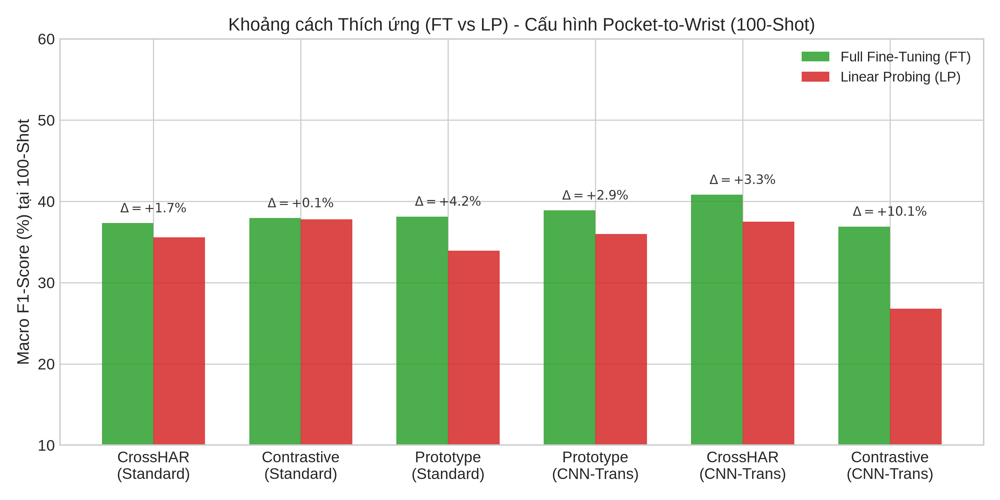
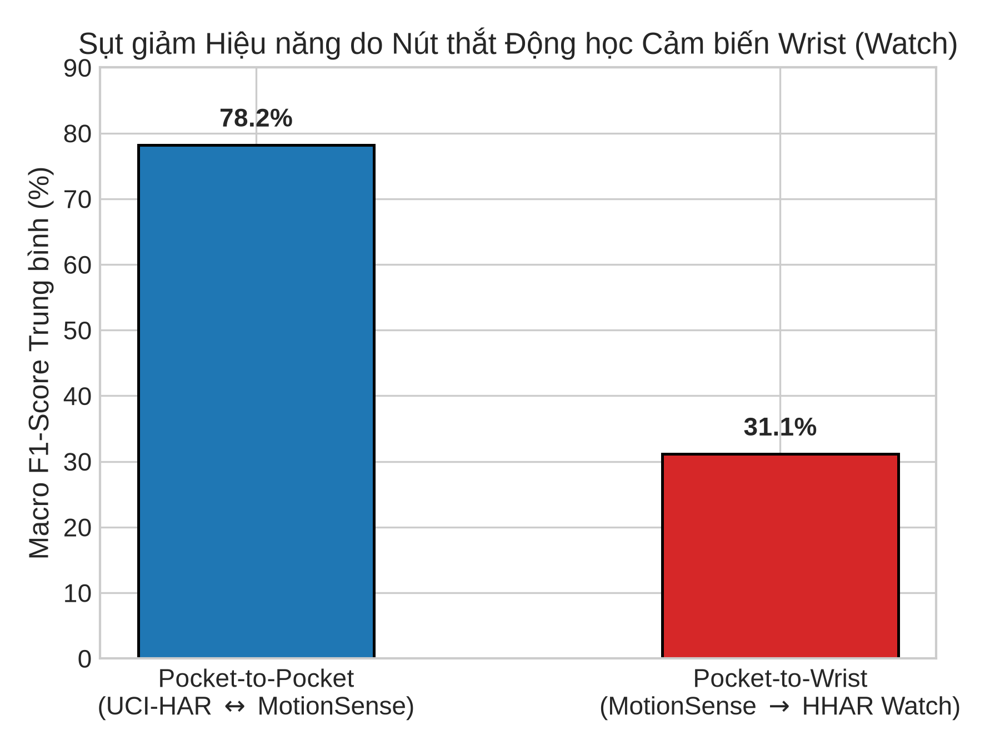

# Cross-Domain HAR: Self-Supervised Learning and Few-Shot Transfer

Nghiên cứu và triển khai các phương pháp **học biểu diễn tự giám sát
(Self-Supervised Learning - SSL)** cho bài toán **nhận dạng hoạt động con
người liên miền (Cross-Domain Human Activity Recognition - Cross-Domain HAR)**.
Mục tiêu của dự án là học đặc trưng từ tín hiệu quán tính không hoặc ít nhãn,
sau đó chuyển mô hình sang một miền cảm biến khác với số lượng mẫu gán nhãn
hạn chế.

> **Trạng thái:** mã nguồn thực nghiệm, pipeline tiền xử lý, pre-training,
> transfer learning, đánh giá K-shot/fraction và các báo cáo kết quả đã được
> tổ chức trong cùng repository. Dữ liệu thô không được đóng gói trong
> repository; cần chuẩn bị riêng theo hướng dẫn bên dưới.

<p align="center">
  
</p>

## Mục lục

- [1. Tổng quan](#1-tổng-quan)
- [2. Bài toán và thiết kế thực nghiệm](#2-bài-toán-và-thiết-kế-thực-nghiệm)
- [3. Dữ liệu](#3-dữ-liệu)
- [4. Phương pháp](#4-phương-pháp)
- [5. Cấu trúc repository](#5-cấu-trúc-repository)
- [6. Cài đặt](#6-cài-đặt)
- [7. Chuẩn bị dữ liệu](#7-chuẩn-bị-dữ-liệu)
- [8. Chạy pipeline](#8-chạy-pipeline)
- [9. Đánh giá và sinh báo cáo](#9-đánh-giá-và-sinh-báo-cáo)
- [10. Kết quả chính](#10-kết-quả-chính)
- [11. Trực quan hóa](#11-trực-quan-hóa)
- [12. Tái lập và kiểm soát chất lượng](#12-tái-lập-và-kiểm-soát-chất-lượng)
- [13. Hạn chế và hướng phát triển](#13-hạn-chế-và-hướng-phát-triển)
- [14. Tài liệu tham khảo trong repository](#14-tài-liệu-tham-khảo-trong-repository)

## 1. Tổng quan

Trong Cross-Domain HAR, mô hình được pre-train trên một **source domain**
nhưng được đánh giá trên **target domain** có phân phối khác. Sự khác biệt có
thể đến từ:

- vị trí cảm biến (túi quần, hông, điện thoại hoặc cổ tay);
- thiết bị, người dùng và cách cầm/đeo;
- tần số lấy mẫu, độ dài chuỗi và tiền xử lý;
- số lượng mẫu có nhãn ở miền đích.

Pipeline của dự án gồm bốn giai đoạn:

```text
Dữ liệu thô
    │
    ▼
Tiền xử lý + chuẩn hóa nhãn + cửa sổ trượt
    │
    ▼
SSL pre-training trên source domain
    │
    ▼
Linear probing hoặc full fine-tuning trên target domain
    │
    ▼
Macro F1 / accuracy / confusion matrix / báo cáo
```

Các câu hỏi thực nghiệm chính:

1. Phương pháp SSL nào tạo ra biểu diễn chuyển giao tốt hơn?
2. Backbone tích chập cục bộ và backbone CNN-Transformer phản ứng thế nào với
   domain shift?
3. Bao nhiêu mẫu nhãn ở miền đích là đủ trong chế độ few-shot?
4. Target `hhar_watch` có tạo ra nút thắt vật lý khác với các domain
   pocket-level hay không?
5. Linear probing có thể dùng như phép kiểm tra nhanh chất lượng biểu diễn
   trước khi fine-tuning toàn bộ mạng hay không?

## 2. Bài toán và thiết kế thực nghiệm

### 2.1. Đầu vào và đầu ra

Mỗi mẫu đầu vào là tensor có dạng `(6, 128)`:

- 6 kênh: 3 trục gia tốc và 3 trục gyroscope;
- 128 bước thời gian;
- tần số mục tiêu 50 Hz, tương đương khoảng 2,56 giây;
- stride 64, tức hai cửa sổ liên tiếp chồng lấp 50%.

Trong cross-domain benchmark, năm lớp chung được sử dụng là:

| ID | Lớp |
|---:|---|
| 0 | Walking |
| 1 | Upstairs |
| 2 | Downstairs |
| 3 | Sitting |
| 4 | Standing |

UCI-HAR có thêm lớp `Laying` và MotionSense có thêm `Jogging`; hai lớp riêng
này không được đưa vào benchmark năm lớp chung.

### 2.2. Các trục thực nghiệm

| Trục | Giá trị |
|---|---|
| Phương pháp | `prototype`, `contrastive`, `crosshar` |
| Backbone | `standard`, `cnn_transformer` (một số script còn hỗ trợ `vit_1d`, `tstcc`) |
| Protocol | `linear_probing`, `full_finetuning` |
| K-shot | tùy cấu hình, ví dụ 10, 20, 50, 100 shot |
| Seed mặc định | 42, 100, 2024, 7, 99 |
| Metric chính | macro F1 (%) |

`linear_probing` đóng băng encoder và chỉ huấn luyện classifier head. Đây là
phép đo trực tiếp tính chuyển giao của biểu diễn. `full_finetuning` cập nhật
toàn bộ encoder và head bằng dữ liệu đích.

### 2.3. Cách đọc kết quả

- Các giá trị báo cáo theo dạng `mean ± std` giữa các seed khi summary có
  thông tin độ lệch chuẩn.
- `N/A` nghĩa là bản ghi không tồn tại; không được diễn giải thành 0.
- So sánh nhiều phương pháp chỉ hợp lệ trên giao các source-target pair có
  cùng shot và protocol.
- Các target chứa `hhar_watch` được phân tích riêng. Đây là khác biệt động học
  giữa cảm biến cổ tay và cảm biến pocket/hip, không chỉ là một thiếu hụt của
  thuật toán.

## 3. Dữ liệu

### 3.1. Các dataset được hỗ trợ

| Tên trong code | Mô tả | Cảm biến/đặc điểm |
|---|---|---|
| `uci_har` | UCI Human Activity Recognition | tín hiệu quán tính 6 kênh, window 128 |
| `motionsense` | MotionSense | gia tốc tổng hợp + rotation rate, 6 kênh |
| `hhar_phone` | Heterogeneity Human Activity Recognition - phone | resample và lọc từ dữ liệu HHAR |
| `hhar_watch` | HHAR - watch | target wrist, được tách thành bottleneck vật lý |

Các source-target pair thường dùng trong code có dạng:

```text
motionsense:uci_har
uci_har:motionsense
motionsense:hhar_phone
uci_har:hhar_phone
motionsense:hhar_watch
uci_har:hhar_watch
```

Tên pair được truyền cho script bằng dấu `:` nhưng thư mục kết quả dùng dạng
`source_to_target`.

### 3.2. Phân chia dữ liệu

- **MotionSense:** subject 1-14 train, 15-18 validation, 19-24 test.
- **UCI-HAR:** subject 27-30 được tách validation từ train gốc; test gốc
  được giữ lại.
- **HHAR:** subject được chia theo cấu hình trong
  [`config/hhar_config.py`](config/hhar_config.py), đồng thời tách phone và
  watch.

Các script giữ `subjects` trong file `.pt` để có thể kiểm tra leakage và phân
tích theo người dùng.

## 4. Phương pháp

### 4.1. Prototype SSL

Phương pháp prototype học các centroid trong không gian embedding. Những mẫu
cùng hoạt động được gom về prototype tương ứng; classifier sau đó có thể hoạt
động với số lượng mẫu nhãn nhỏ. Cách tiếp cận này phù hợp với few-shot vì
quyết định dựa trên hình học lớp thay vì chỉ phụ thuộc vào một head lớn.

### 4.2. Contrastive SSL (TS-TCC)

Contrastive learning tạo các view được augment của chuỗi thời gian, kéo các
view dương lại gần và tách các mẫu âm. Trong repository, checkpoint contrastive
được lưu với tiền tố `tstcc`.

### 4.3. CrossHAR

CrossHAR kết hợp học đặc trưng hoạt động với mục tiêu giảm khác biệt giữa các
miền. Alignment có thể cải thiện chuyển giao trong cùng loại cảm biến, nhưng
không thể loại bỏ hoàn toàn khác biệt động học giữa wrist và pocket.

### 4.4. Backbone

- `standard`: encoder 1D-CNN, có bias cục bộ phù hợp với các pattern chu kỳ
  trong tín hiệu cảm biến.
- `cnn_transformer`: CNN trích xuất đặc trưng cục bộ, Transformer mô hình hóa
  quan hệ xa trong cửa sổ.
- `vit_1d` và `tstcc`: được hỗ trợ trong một số script pre-training/legacy;
  cần kiểm tra tương thích checkpoint trước khi dùng cho benchmark chính.

## 5. Cấu trúc repository

```text
CrossDomain-HAR-SSL/
├── config/                  # Đường dẫn, label map, window và subject split
├── data/
│   ├── raw/                 # Dữ liệu thô, không commit
│   └── processed/           # Các file train.pt/val.pt/test.pt
├── datasets/                # Dataset và data loader
├── engines/
│   ├── pretrain_ssl/        # Trainer SSL
│   ├── transfer/            # Fine-tuning và transfer
│   └── evaluation/          # Tính metric
├── models/
│   ├── encoders/            # standard, CNN-Transformer, ViT-1D, TS-TCC
│   ├── heads/               # classifier/projection head
│   └── ssl/                 # model prototype, contrastive, CrossHAR
├── scripts/
│   ├── 00_preprocess/       # Đóng gói dữ liệu
│   ├── 01_baseline/         # Baseline supervised
│   ├── 02_pretrain_ssl/     # SSL pre-training
│   ├── 03_cross_domain/     # K-shot/fraction transfer
│   └── 04_results/          # Aggregate, plot, report
├── checkpoints/             # Checkpoint pre-training
├── outputs_evaluation/      # JSON, confusion matrix và kết quả đánh giá
├── plots/                   # Hình dùng trong README/báo cáo
├── figures/                 # Hình embedding và pre-training
├── document/                # Tài liệu dataset, log và báo cáo cũ
└── section/                 # Báo cáo Cross-Domain hiện tại
```

## 6. Cài đặt

### 6.1. Yêu cầu

- Linux/Ubuntu khuyến nghị;
- Python 3.11;
- PyTorch 2.x và torchvision tương thích;
- GPU CUDA được khuyến nghị cho pre-training/fine-tuning;
- tối thiểu khoảng trống đĩa đủ cho dữ liệu `.pt`, checkpoint và output.

Các phiên bản tối thiểu được ghi trong
[`requirements.txt`](requirements.txt). Có thể dùng `uv` hoặc `venv` tiêu
chuẩn:

```bash
git clone https://github.com/Dungx1107/CrossDomain-HAR-SSL.git
cd CrossDomain-HAR-SSL

python3.11 -m venv .venv
source .venv/bin/activate
python -m pip install --upgrade pip
python -m pip install -r requirements.txt
```

Với `uv`:

```bash
uv venv --python 3.11
source .venv/bin/activate
uv pip install -r requirements.txt
```

Kiểm tra PyTorch và CUDA:

```bash
python - <<'PY'
import torch
print("PyTorch:", torch.__version__)
print("CUDA available:", torch.cuda.is_available())
if torch.cuda.is_available():
    print("GPU:", torch.cuda.get_device_name(0))
PY
```

Nếu chạy trên Kaggle, một số config tự động chuyển root dữ liệu/output sang
`/kaggle/input` và `/kaggle/working` khi biến môi trường
`KAGGLE_KERNEL_RUN_TYPE` tồn tại.

## 7. Chuẩn bị dữ liệu

### 7.1. Đặt dữ liệu thô

Đặt dữ liệu theo cấu trúc mà các config trỏ tới:

```text
data/raw/
├── uci_har/
│   ├── train/
│   └── test/
├── motion_sense/
└── hhar/
```

Chi tiết tên file UCI-HAR, cột MotionSense và format HHAR được mô tả trong:

- [`document/1_datasets/motionsense_specification.md`](document/1_datasets/motionsense_specification.md)
- [`config/uci_har_config.py`](config/uci_har_config.py)
- [`config/motionsense_config.py`](config/motionsense_config.py)
- [`config/hhar_config.py`](config/hhar_config.py)

### 7.2. Chạy tiền xử lý

Các script tiền xử lý không nhận nhiều tham số dòng lệnh; chúng đọc đường dẫn
từ `config/` và ghi output vào `data/processed/`:

```bash
python scripts/00_preprocess/preprocess_uci_har.py
python scripts/00_preprocess/preprocess_motionsense.py
python scripts/00_preprocess/preprocess_hhar.py
```

Mỗi dataset sau khi xử lý cần có tối thiểu:

```text
data/processed/<dataset>/
├── train.pt
├── val.pt
├── test.pt
└── dataset_all.pt
```

Kiểm tra nhanh chất lượng dữ liệu:

```bash
python utils/check_data_quality.py
```

## 8. Chạy pipeline

### 8.1. Baseline supervised

```bash
python scripts/01_baseline/run_train_baseline.py
python scripts/01_baseline/run_eval_baseline.py
```

K-fold baseline:

```bash
python scripts/01_baseline/run_kfold_baseline.py
```

### 8.2. SSL pre-training

Prototype:

```bash
python scripts/02_pretrain_ssl/run_pretrain_prototype.py \
  --backbone standard \
  --datasets uci_har motionsense \
  --epochs 40 \
  --batch_size 64
```

Contrastive/TS-TCC:

```bash
python scripts/02_pretrain_ssl/run_pretrain_contrastive.py \
  --backbone cnn_transformer \
  --datasets uci_har motionsense \
  --epochs 60 \
  --batch_size 64
```

CrossHAR:

```bash
python scripts/02_pretrain_ssl/run_crosshar_pretrain.py \
  --backbone standard \
  --datasets motionsense \
  --epochs 60 \
  --warmup_msm_epochs 15 \
  --batch_size 64
```

Checkpoint thường được đặt dưới
`checkpoints/ssl_pretrain/<method>/<source>/<backbone>/`. Script transfer kiểm
tra sự tồn tại của checkpoint và sẽ báo lỗi rõ ràng nếu thiếu.

### 8.3. K-shot cross-domain

Ví dụ chuyển từ MotionSense sang UCI-HAR:

```bash
python scripts/03_cross_domain/run_few_shot.py \
  --method prototype \
  --backbone standard \
  --k_shots 10 20 50 100 \
  --seeds 42 100 2024 7 99 \
  --epochs 40 \
  --batch_size 16 \
  --pairs motionsense:uci_har
```

Có thể truyền nhiều pair trong một lần chạy:

```bash
python scripts/03_cross_domain/run_few_shot.py \
  --method crosshar \
  --backbone cnn_transformer \
  --k_shots 10 20 50 100 \
  --pairs motionsense:uci_har uci_har:motionsense motionsense:hhar_watch
```

Mỗi cấu hình sinh:

```text
outputs_evaluation/cross_k_shot/<method>/<backbone>/<source>_to_<target>/
├── experiment_metadata.json
└── <k>_shot/
    ├── linear_probing/
    │   ├── summary_*.json
    │   ├── detailed_all_seeds.json
    │   └── aggregated_confusion_matrix.png
    └── full_finetuning/
        ├── summary_*.json
        ├── detailed_all_seeds.json
        └── aggregated_confusion_matrix.png
```

### 8.4. Fraction-based adaptation

Ngoài K-shot, pipeline hỗ trợ lấy một tỷ lệ dữ liệu train đích:

```bash
python scripts/03_cross_domain/run_cross_domain.py \
  --method prototype \
  --backbone standard \
  --fractions 0.01 0.05 0.10 \
  --seeds 42 100 2024 7 99 \
  --epochs 40 \
  --batch_size 16 \
  --pairs motionsense:uci_har
```

Kết quả được ghi dưới
`outputs_evaluation/cross_fraction/<method>/<backbone>/`.

## 9. Đánh giá và sinh báo cáo

Sinh báo cáo Markdown từ toàn bộ cây K-shot:

```bash
python scripts/04_results/cross_domain_har_reporter.py \
  --input outputs_evaluation/cross_k_shot \
  --output section/Bao_Cao_Cross_Domain_HAR.md
```

Các công cụ hỗ trợ:

```bash
python scripts/04_results/aggregate_k_shot.py
python scripts/04_results/aggregate_fraction.py
python scripts/04_results/plot_charts.py
python scripts/04_results/plot_hybrid_grid.py
```

Báo cáo phân tích chi tiết hiện có tại
[`section/Bao_Cao_Phan_Tich_Cross_Domain_HAR.md`](section/Bao_Cao_Phan_Tich_Cross_Domain_HAR.md).
Báo cáo sinh tự động và phiên bản LaTeX nằm trong thư mục
[`section/`](section/).

## 10. Kết quả chính

Các nhận xét dưới đây được tổng hợp từ kết quả hiện có trong repository, không
phải là cam kết cho mọi seed hoặc mọi pair mới:

- Ở cấu hình pocket-level, backbone `standard` nhìn chung ổn định hơn
  `cnn_transformer`, đặc biệt trong linear probing.
- Ở 100-shot, linear probing trên `standard` cho macro F1 trung bình khoảng
  **73,68% CrossHAR**, **70,72% Prototype** và **72,20% Contrastive** theo
  các giao pair khả dụng tương ứng trong báo cáo. Số pair không giống nhau,
  vì vậy không nên đọc các giá trị này như một bảng xếp hạng tuyệt đối.
- Contrastive + CNN-Transformer có mức tăng FT so với LP lớn, cho thấy
  representation cần adaptation thêm ở miền đích.
- Lợi ích của shot tăng mạnh ở vùng ít nhãn và có xu hướng bão hòa khi tiến
  tới 100 shot.
- Các target `hhar_watch` suy giảm đáng kể so với pocket-level. Sự suy giảm
  này phù hợp với physical domain shift do vị trí đeo cổ tay.
- Cấu hình có macro F1 cao nhất trên một pair pocket-level được báo cáo là
  **Prototype + standard + 100-shot + full fine-tuning**, trên
  **MotionSense -> UCI-HAR**. Đây là kết quả theo pair cụ thể, không phải
  trung bình toàn bộ miền.
- Cấu hình thực dụng về số lượng nhãn được báo cáo là Prototype + standard +
  50-shot + full fine-tuning; tuy nhiên repository chưa có FLOPs, latency và
  memory đầy đủ, nên chưa thể gọi đây là trade-off compute tối ưu.

### Hình minh họa kết quả

<p align="center">
  
  
</p>
<p align="center"><em>So sánh protocol adaptation ở pocket-level và wrist-level.</em></p>

<p align="center">
  
</p>

## 11. Trực quan hóa

Các hình đã có trong repository:

| Hình | Nội dung |
|---|---|
| [`plots/k_shot_scaling_curves.png`](plots/k_shot_scaling_curves.png) | Đường cong macro F1 theo số shot |
| [`plots/protocol_adaptation_gap.png`](plots/protocol_adaptation_gap.png) | Khoảng cách FT-LP |
| [`plots/protocol_adaptation_gap_pocket.png`](plots/protocol_adaptation_gap_pocket.png) | FT-LP trên pocket-level |
| [`plots/protocol_adaptation_gap_wrist.png`](plots/protocol_adaptation_gap_wrist.png) | FT-LP trên wrist-level |
| [`plots/wrist_domain_bottleneck.png`](plots/wrist_domain_bottleneck.png) | So sánh nút thắt `hhar_watch` |
| [`plots/few_shot_benchmark/tstcc_vs_prototype_comparison.png`](plots/few_shot_benchmark/tstcc_vs_prototype_comparison.png) | Contrastive/Prototype few-shot |
| [`figures/pretrain/prototype/tsne_plots/300_tsne_standard.png`](figures/pretrain/prototype/tsne_plots/300_tsne_standard.png) | t-SNE embedding của standard |

Các visualization nên được giữ nhất quán với báo cáo:

1. **100-shot grouped bar:** X = method, Y = macro F1, hue = backbone,
   error bar = std; đặt sau bảng so sánh method.
2. **Shot learning curve:** X = số shot, Y = macro F1, mỗi đường là
   method/backbone/protocol; đặt trong phần data efficiency.
3. **Source-target heatmap:** hàng = source, cột = target, annotation =
   macro F1 của cấu hình tốt nhất; đặt trong phần transfer asymmetry.
4. **Seed-level boxplot:** X = method, Y = F1 từng seed, hue = shot; đặt
   trong phần ổn định seed.

Nếu `detailed_all_seeds.json` không có seed-level metric thì không được thay
boxplot bằng một proxy; cần ghi rõ dữ liệu không khả dụng.

## 12. Tái lập và kiểm soát chất lượng

Để tái lập một thí nghiệm:

1. ghi lại commit Git, Python/PyTorch/CUDA và GPU;
2. giữ nguyên danh sách seed, pair, shot/fraction, epoch và batch size;
3. kiểm tra checkpoint đúng method, source và backbone;
4. không trộn các lớp riêng `Laying`/`Jogging` vào benchmark năm lớp;
5. kiểm tra `experiment_metadata.json` sau mỗi lần chạy;
6. dùng cùng giao source-target pair khi so sánh các method;
7. kiểm tra các record có `std > 5` điểm phần trăm và báo cáo như biến động
   cao;
8. xem riêng confusion matrix để phát hiện nhầm lẫn giữa `Walking`,
   `Upstairs` và `Downstairs`.

Không commit dữ liệu thô, checkpoint lớn, thông tin API/token hoặc file sinh
ra có chứa dữ liệu nhạy cảm. Khi chia sẻ kết quả, nên chia sẻ JSON summary,
metadata và script tạo hình thay vì chỉ chia sẻ ảnh.

## 13. Hạn chế và hướng phát triển

- Coverage giữa các method/backbone/shot/protocol chưa luôn cân bằng.
- Một số aggregate có số pair khác nhau; ranking cần được đọc cùng số pair
  khả dụng.
- Cần thêm seed và kiểm định paired trên cùng pair để tăng độ tin cậy thống kê.
- Cần ghi nhận FLOPs, peak memory, latency và thời gian fine-tuning để đánh
  giá accuracy/compute đúng nghĩa.
- `hhar_watch` cần được xem như một cluster vật lý riêng, có thể cần
  normalization theo sensor axis, augmentation nhận thức vị trí đeo và dữ
  liệu chuyển động tay đa dạng hơn.
- Nên bổ sung đánh giá subject-wise và mở rộng factorial design cho các cấu
  hình 10/20 shot còn thiếu.

## 14. Tài liệu tham khảo trong repository

Các tài liệu và log thực nghiệm được lưu tại:

- [`document/0_reports/`](document/0_reports/)
- [`document/1_datasets/`](document/1_datasets/)
- [`document/2_code_docs/`](document/2_code_docs/)
- [`document/references/`](document/references/)
- [`section/Bao_Cao_Phan_Tich_Cross_Domain_HAR.md`](section/Bao_Cao_Phan_Tich_Cross_Domain_HAR.md)

Nếu sử dụng mã nguồn hoặc kết quả, hãy trích dẫn bài báo/dataset gốc tương
ứng và ghi rõ phiên bản commit của repository dùng để chạy thực nghiệm.
